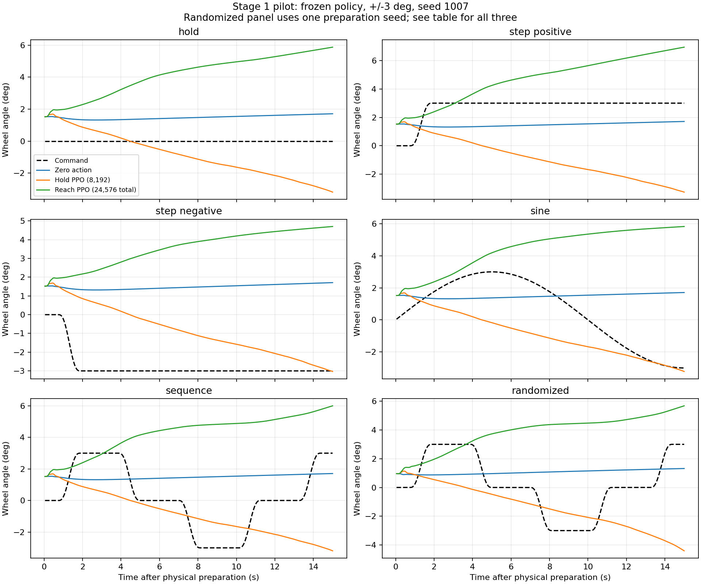

# 集中式腕手 GRU：第一轮探索（2026-10-22）

本轮实现了独立的集中式腕手策略，并完成保持及 ±3°的小规模试训。**当前结果尚未达到第一阶段精度门槛，不能进入换手或实物部署。**它不覆盖原有 residual 模型和 baseline。这里的“探索完成”不等于能力验收通过。

## 实现与学习边界

单步 140 维本体/轮角/目标预览 → MLP(256,128) → GRU(128) → 24 维动作。前 12 维独立控制双腕平移和旋转，后 12 维控制双手各六个驱动的闭合目标；联合 14 变量 IK/QP 将腕部命令转换为双臂关节目标，限幅 PD 驱动机器人与被动方向盘接触。

**执行层没有轮角误差运动控制器，也没有随目标轮角移动的圆弧腕部执行参考。**目标角序列与角速度参考仍由确定性平滑器提供；PPO 不负责规划方向盘期望速度，负责学习机器人如何运动来跟随指令。静态初始 IK、已知轮轴坐标以及第一阶段几何奖励仍保留，不能称为未知几何条件下的端到端学习。

Actor 不读接触力、模拟力矩、摩擦系数或从动手指关节；critic 使用额外 54 维特权观测。GRU 隐状态跨步保留、跨回合清零，已导出不含 critic 的 TorchScript actor。实物是否能取得所需的主动驱动位置读数及其标定尚未验证。

完整输入输出、执行限幅、奖励及命令见 [技术说明](../../docs/EXPLORATION_STAGE1.md)。新代码在 [exploration](../../src/wheel_manipulation/exploration/)。

## 训练规模与对照

| 模型 | 训练目标 | 新增策略步数 | 累计步数 | 完整训练回合 | 训练耗时 |
| --- | --- | ---: | ---: | ---: | ---: |
| hold_s7_pilot | 保持 0° | 8,192 | 8,192 | 27 | 105.2 s |
| reach3_s7_pilot | ±3°混合指令，继承 hold 权重 | 16,384 | 24,576 | 54 | 223.7 s |

只有 **一个训练种子 7**，CPU 单线程、一个环境，策略/机器人/物理频率分别为 20/50/500 Hz。上述完整训练回合均到时间上限；各段最后的未完整回合不计入表格。训练步数约相当于 20.5 分钟的策略执行时间，不是充分收敛训练。

冻结后比较零动作、保持模型和 ±3°模型。每个控制器使用五个名义 15 秒场景（保持、正阶跃、负阶跃、正弦、往返序列）以及三个随机化准备状态的 15 秒往返场景，共 24 回合。名义场景不使用重复确定性种子冒充独立初态证据。保持模型没见过非零训练目标，其非零目标测试只用于诊断。

随机化测试改变闭合目标 ±0.08 rad、准备时长 ±0.2 s，并将原有动力学/观测随机化强度设为 0.5；训练对应值为 ±0.04 rad、±0.12 s、0.15。接触由物理闭合形成，没有直接设定初始接触力。

模型与原始日志：

- [保持 checkpoint](../../runs/exploration_stage1/hold_s7_pilot/final.pt)、[训练元数据](../../runs/exploration_stage1/hold_s7_pilot/config.json)。
- [±3°checkpoint](../../runs/exploration_stage1/reach3_s7_pilot/final.pt)、[部署 actor](../../runs/exploration_stage1/reach3_s7_pilot/actor.pt)、[训练元数据](../../runs/exploration_stage1/reach3_s7_pilot/config.json)。
- [顺序评价日志](../../outputs/exploration_stage1/evaluation.log)。元数据保存场景和源码 SHA256；评价 summary 另存模型和评价器 SHA256。评价器在训练结束后收紧了保持精度门槛，没有修改训练后的网络或执行器。

## 对照结果

误差单位均为度。阶跃列出最后 5 秒 RMSE，其他名义场景列出全段 RMSE；随机化为三个准备种子的全段 RMSE 均值 ±总体标准差，仅作描述性统计。

| 指标 | 零动作 | 保持 PPO | ±3°PPO |
| --- | ---: | ---: | ---: |
| 保持 RMSE | 1.493 | 1.598 | 4.333 |
| +3°阶跃末段 RMSE | 1.374 | 5.438 | 3.329 |
| −3°阶跃末段 RMSE | 4.627 | 0.862 | 7.477 |
| 正弦 RMSE | 2.305 | 2.041 | 4.813 |
| 往返序列 RMSE | 2.396 | 2.356 | 4.805 |
| 随机化往返 RMSE，n=3 | 2.456 ±0.188 | 2.425 ±0.219 | 4.972 ±0.386 |
| 完整执行回合 | 8/8 | 8/8 | 8/8 |
| 通过短回合精度门槛 | 0/8 | 1/8 | 0/8 |

保持模型只有负阶跃末段通过，曲线显示它在多个指令下都持续向负向移动，因此这个孤立通过不能证明学会了负向目标跟踪。新模型整体劣于零动作；本轮不能报告 PPO 的跟踪收益。

正负目标的配对末段实际轮角均值为：

| 控制器 | +3°指令下实际轮角 | −3°指令下实际轮角 | 正负响应差（理想 6°） |
| --- | ---: | ---: | ---: |
| 零动作 | +1.627° | +1.627° | 0.000° |
| 保持 PPO | −2.418° | −2.250° | −0.168° |
| ±3°PPO | +6.308° | +4.476° | +1.832° |

这支持“新模型已有较弱的目标方向响应，但存在更大的共同正向偏移”的判断，不支持“能够稳定到达并保持目标”。两种阶跃使用完全相同的物理准备，且零动作轨迹完全相同，便于区分指令响应与初始接触自行带动的转动。

三个控制器的轮盘单接触点峰值力最大分别为 4.49/8.26/6.03 N，机器人碰撞诊断峰值均为 0 N，未触发载荷/丢失握持/IK 失败终止。几何握持漂移代理最大分别为 0.81/2.69/2.40°，新模型也未改善该指标。这里是当前仿真模型的诊断，不能推断实物接触安全。

随机化准备的初始轮角约为 +0.97°到 +1.94°，双手各自的轮盘接触力范数之和约为 12.7–18.6 N，说明实际测试确实包含不同接触状态，并非只替换了随机种子。三个准备状态远不足以确定实物初始接触的覆盖范围。

- [完整比较 CSV](comparison.csv)、[JSON 与配对统计](comparison.json)。
- [目标/实际轮角曲线](tracking.png)、[15 秒往返演示视频](../../outputs/exploration_stage1/reach3_nominal/sequence_s1007.mp4)、[视频预览](video_preview.png)。视频含初始帧共 301 帧，20 fps，960×540；软件渲染耗时不计入训练时间。
- 原始逐步 CSV、任务配置、准备状态和模型哈希保存在 `outputs/exploration_stage1/{zero,hold,reach3}_{nominal,randomized}/`。



## 已确认的问题与解释边界

1. 名义物理准备结束时，轮角已经约为 +1.52°，而保持指令是绝对 0°。零动作的末段轮角约 +1.63°；它既包含初始接触偏置，也包含后续接触动力学，不能把这个误差全称为策略漂移。
2. 保持模型在正负目标下都逐步向负向移动。±3°模型在正负目标下都向正向移动。配对测试表明后者有一定指令方向敏感性，但较大的共同正向偏移仍占主导，尚未学会稳定闭环跟踪。
3. 指令生成器存在可确认的方向分布偏置：正弦和往返均从正向开始。独立生成 300 条每类 15 秒指令诊断时，正弦约 70.1%时间为正、29.6%为负，往返约 39.3%为正、28.0%为负。该诊断不是实际训练采样日志；它确认生成器不对称，**尚不能单独证明这是失败的唯一原因**。[诊断数据](command_generator_diagnostic.json)。
4. 移除旧圆弧执行层后，策略需要同时协调双腕 12 维和手部 12 维。当前短预算和逐步独立高斯探索可能难以发现持续、双臂一致的运动；这是需要实验验证的解释。没有足够证据归咎于 GRU、PPO 算法本身或所参考的论文方法。

## 后续对策（本轮未执行）

优先对称化目标：按正负成对训练，随机化正弦/往返的起始方向，并在小角度混合训练中保留保持回合。固定当前 140/24 接口，先证明 ±1°和 ±3°下的双向响应及停止保持，再增加预算和训练种子。

若对称目标仍只能产生共同偏移，再做单因素探索消融：改变腕部探索的时间相关性、奖励尺度或课程安排，每次对照保持、正负阶跃和随机化初始接触；不同时改网络、动作和奖励。早期可暂时限制手部探索幅度作为训练课程，但最终仍评估完整腕手联合控制。

先达到短回合 RMSE 门槛，再评估 60–300 秒往返、多训练种子及更强初态扰动。通过后才扩展 ±10°及释放/重抓。稀疏掌部/肘部 QP 几何约束不是完整手指、全身或驾驶室避碰保证；当前也没有开展视觉遮挡学习。

## 结果判定口径

保持整段及末 5 秒 RMSE 均 ≤1°；正负阶跃末 5 秒 RMSE ≤1°；正弦及往返整段 RMSE ≤1°且峰值误差 ≤5°，均须完整执行。`max_hold_seconds` 是原有 2°误差及速度阈值的粗诊断，不能替代 1°精度判断。两个早期 `*_hold_smoke` 的通过字段采用旧粗门槛，正式对照以各 summary 的 `criteria` 为准。

`max_grasp_drift_deg` 是手腕相位与轮角之差的几何代理，不能直接等同于真实指尖滑移。`peak_contact_force_n` 是单个轮盘接触点的最大力范数，不是整只手总握力。完成回合仅代表未触发当前仿真终止条件，不证明实物安全。`accepted_in_simulation` 和 `hardware_ready` 均保持 false。

## 验证与复现

完整 manipulation 测试 **16/16 通过**，覆盖原有接口回归、新执行层不写物理状态/不存在轮角 servo、被动轮无执行器、actor 特权隔离、手部全范围映射、GRU 清零、TorchScript 一致性、超时 GAE 与物理准备的可重复随机化。[测试日志](tests.log)。Gym 的无限观测边界提示不影响测试通过。

从 manipulation 目录执行；运行命令及新输出目录要求见 [技术说明](../../docs/EXPLORATION_STAGE1.md)。

```bash
MUJOCO_GL=osmesa LP_NUM_THREADS=1 bash scripts/run.sh \
  scripts/evaluate_exploration_stage1.py --output outputs/exploration_stage1_recheck
bash scripts/run.sh scripts/summarize_exploration_stage1.py \
  --input outputs/exploration_stage1_recheck --output results/exploration_stage1_recheck
bash scripts/run.sh -m unittest discover -s tests -v
```

汇总脚本仅分析已有 CSV/JSON 和纯指令生成器，不启动仿真；评价脚本每次只运行一个环境。部署 actor 已导出不代表实物可用，当前没有上游/CARLA、视觉、换手或实物测试，也没有以重复评估代替多个训练种子的验证。
