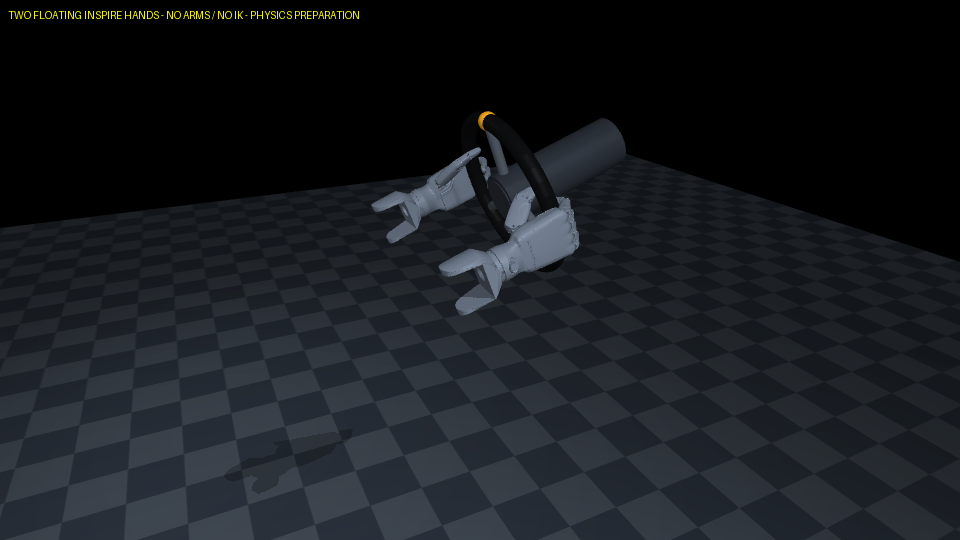

# 去掉机械臂后的双手物理诊断

日期：2026-10-23。环境与接口见[技术说明](../../../docs/HAND_ONLY.md)。场景只含两只浮动Inspire手和轮盘，没有机械臂或IK。本次没有训练/评估学习策略，也不把结果用来证明原IK或原policy是漂移的唯一原因。

## 协议

同一个名义初态、每种情况6秒。先物理闭合并稳定1.2秒；两手初始接触力范数求和读数分别约8.18N、7.37N，准备后轮角约1.718°。这些读数不是抓握力标定值。

保持：腕部目标固定。正/反转：前4秒按±2°/s的预定腕部运动，后2秒停止输入速度；脚本只使用已知几何与时间，没有目标轮角误差伺服。目标变化共±8°，相对于物理准备后的轮角积分。另做同动作但禁用手轮接触的因果对照。

| 测试 | 实际轮角净变化 | 相对脚本积分参考的RMSE | 双手接触比例 | 最大几何漂移代理 |
| --- | ---: | ---: | ---: | ---: |
| 固定腕部目标 | −0.964° | 0.876° | 100% | 1.404° |
| 正向预设运动 | +6.550° | 1.509° | 100% | 1.961° |
| 反向预设运动 | −8.704° | 0.554° | 100% | 1.415° |
| 正向运动、禁用手轮接触 | 0.000° | 5.985° | 0% | 不作为握持质量指标 |

最大腕部位置误差约10.3–10.6mm（有接触三组）。当前跨手碰撞诊断为0N，只有这次名义短时诊断的含义。几何漂移代理是手掌相对轮盘材料相位的变化，不是真实指尖滑移。

## 结论

1. 移除手臂与IK后，两只手仍能通过物理接触双向带动轮盘。
2. 禁用接触后轮盘不动，说明这组运动并非通过直接写轮角或轮轴执行器实现。
3. 固定目标仍有约0.96°的被动调整，腕部接触下有约1cm顺应偏差；手指接触、腕部执行响应和停止保持仍需研究，移除IK不代表这些问题自动消失。
4. 这些是脚本可行性证据。只有一个名义初态，没有负载/初态随机化、长时闭环或自主换手结果；不与旧PPO的不同测试协议直接作性能比较。

32项测试全部通过，包括4项新增边界：没有臂关节且保留12条联动、腕部命令不直接写物理状态且无接触不能转轮、包含补偿在内的虚拟腕部合力/力矩受限、actor不依赖接触读数或从动指节真值。完整日志见[tests.log](tests.log)。

原始记录：[summary.json](summary.json)、[保持](hold.csv)、[正向](positive.csv)、[反向](negative.csv)、[无接触对照](no_contact_positive.csv)。下一步以这个新接口独立训练，评估按时跟踪及保持段手掌/手指运动，而非只看轮角到达。
