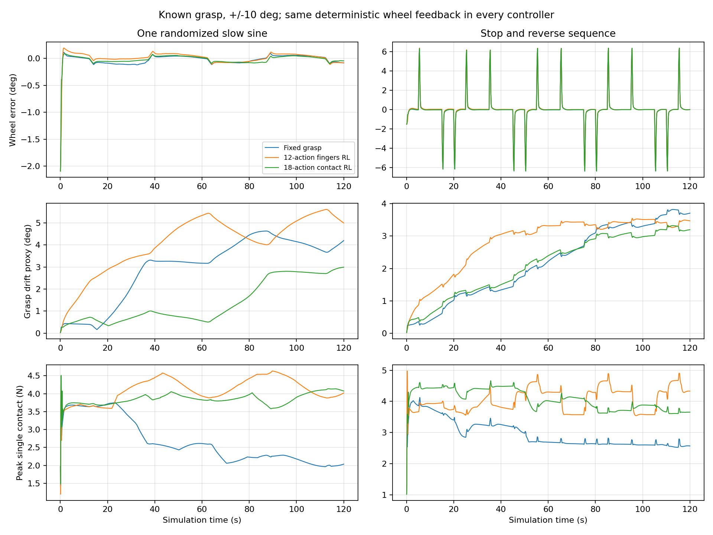
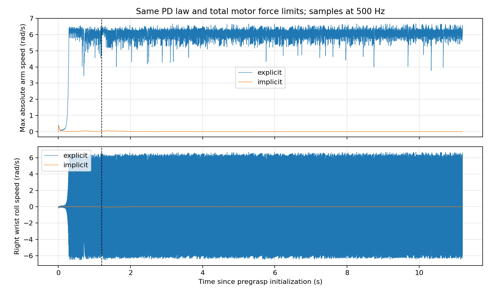

# 共同运动与臂手接触RL：首轮小角度实验

本轮完成独立场景、主18维PPO训练和独立12维手指消融。所有控制都使用同一个确定性轮角反馈与连续IK/QP；RL学习接触修正。轮盘只受真实模拟接触驱动。**这是开发阶段小角度试验，尚未完成仿真最终验收或实物迁移。**

低误差主要由共同运动控制器提供。主策略有一些降低握持漂移的结果，但伴随更高负载；目前没有证明明显的跟踪优势。停留反向的最大误差超过5°要求，不能由慢正弦的低RMSE替代。

## 协议与训练预算

从同一个已知预抓握起点开始，目标幅值±10°。慢正弦0.02Hz、较快正弦0.10Hz；停留反向每5秒依次发布0/+10/+10/0/−10/0°端点，目标生成器仍以20°/s限速。三个控制使用相同物理场景、目标、初态、随机化强度和测试种子；汇总脚本逐项检查这些配对条件。

训练种子只有7。主方法和手指对照各完成32768步握持及32768步到达训练，训练计算预算各65536步。第二阶段都从各自握持阶段8192步的最佳模型恢复；最终模型累计40960步。评价统一使用各阶段EvalCallback按训练验证回报选出的best模型，没有按下表挑选checkpoint。最佳模型的有效累计步数不同，这不是等有效学习步数的消融。每个模型的选中步数和SHA-256见summary.json。

| 模型 | 阶段 | 新增训练步 | 最终累计步 | 最佳模型累计步 |
|---|---|---:|---:|---:|
| 18维臂手 | grasp | 32768 | 32768 | 8192 |
| 12维手指 | grasp | 32768 | 32768 | 8192 |
| 12维手指 | reach10 | 32768 | 40960 | 16384 |
| 18维臂手 | reach10 | 32768 | 40960 | 40960 |

## 配对结果

−10°/0°/+10°各60秒保持评价：

| 控制 | −10° RMSE | 0° RMSE | +10° RMSE | 连续10秒保持 |
|---|---:|---:|---:|---|
| 固定握持 | 0.6110° | 0.1198° | 0.4154° | 3/3通过 |
| 仅手指RL（12维） | 0.6326° | 0.1335° | 0.3989° | 3/3通过 |
| 臂手接触RL（18维，主方法） | 0.5925° | 0.1105° | 0.4370° | 3/3通过 |

动态轨迹全程统计：

| 轨迹 | 控制 | RMSE（°） | 最大误差（°） | 握持漂移代理峰值（°） | 单接触力峰值（N） | 跟踪要求 |
|---|---|---:|---:|---:|---:|---|
| 慢正弦，600s | 固定握持 | 0.06465 | 1.4591 | 4.2254 | 4.0418 | 通过 |
| 慢正弦，600s | 仅手指RL（12维） | 0.06639 | 1.4591 | 4.1581 | 4.9905 | 通过 |
| 慢正弦，600s | 臂手接触RL（18维，主方法） | 0.06293 | 1.4586 | 3.7849 | 4.4852 | 通过 |
| 随机化慢正弦，120s | 固定握持 | 0.11738 | 2.0950 | 4.6288 | 3.7507 | 通过 |
| 随机化慢正弦，120s | 仅手指RL（12维） | 0.12655 | 2.0950 | 5.6049 | 4.6326 | 通过 |
| 随机化慢正弦，120s | 臂手接触RL（18维，主方法） | 0.10361 | 2.0945 | 2.9891 | 4.5078 | 通过 |
| 停留反向，120s | 固定握持 | 1.41920 | 6.3908 | 3.8211 | 4.1243 | 未通过 |
| 停留反向，120s | 仅手指RL（12维） | 1.41755 | 6.3819 | 3.5465 | 4.9775 | 未通过 |
| 停留反向，120s | 臂手接触RL（18维，主方法） | 1.41910 | 6.3813 | 3.3333 | 4.6639 | 未通过 |
| 较快正弦，120s | 固定握持 | 0.32554 | 1.2078 | 3.8495 | 4.0750 | 通过 |
| 较快正弦，120s | 仅手指RL（12维） | 0.32549 | 1.2078 | 3.6685 | 5.0504 | 通过 |
| 较快正弦，120s | 臂手接触RL（18维，主方法） | 0.32700 | 1.2073 | 3.3344 | 4.5556 | 通过 |

动态要求为RMSE≤2°、最大误差≤5°、完成请求时长且不提前失败。单接触力不是整只手合力；接触力记录取500Hz物理步内峰值。握持漂移是掌部绕轮轴相位相对轮角的变化，可能包含接触重排、姿态/几何误差，不是指腹切向滑移或力闭合测量。

固定参数使用seed1001，随机化样本使用seed1002，停留反向/较快正弦使用seed1003。随机化测试包含摩擦、阻尼、惯量、执行参数、观测噪声与时延，但只有一个参数样本，不能作为统计显著性或鲁棒性证明。

停留反向的高误差是起步/运动变化时的短时落后，不是正向准、反向不准：主策略第一次从0°向+10°起步时已有约6.32°误差，从0°向−10°时约6.38°。慢正弦最大目标速度约1.26°/s，而停留后起步的目标速度跳至20°/s；共同参考加速度限制80°/s²，理想情况下从静止加到20°/s也需0.25s，实际臂手运动还有滞后。当前目标在50ms物理执行周期末更新，执行使用上一周期目标，日志比较则使用周期末目标；该时序最多对应1°的目标变化。仅作诊断而与执行时持有的上一目标对齐后，固定/主策略峰值仍约5.47°/5.46°，依然超过5°。正式统计没有改为这个诊断口径。

主策略在停留反向的2秒后，共同相位修正仅在-0.1661°至-0.1600°之间变化。当前腕部行为更接近小幅姿态调校；尚不能证明已经学会针对滑移的持续自适应。完整六项腕部修正范围在summary.json中。

## 执行层问题与修正

显式力矩PD的逐物理步速度阻尼在抓握初始化中激发了右腕roll数值振荡。v2改为force-limited affine PD，由implicitfast隐式积分阻尼。刚度、阻尼、重力/偏置前馈及总电机力矩限幅保持一致，没有给轮盘增加驱动，也没有添加无限外力。

相同预抓握物理状态，500Hz采样，包含1.2秒抓握初始化及10秒中心保持：

| 执行 | 实际臂速峰值 rad/s | 右腕相邻速度相关 | 保持轮角RMSE ° | 最终握持漂移代理 ° | 最大电机力/限幅 |
|---|---:|---:|---:|---:|---:|
| explicit | 6.6738 | -0.9975 | 0.5015 | 6.6866 | 1.0000 |
| implicit | 0.3361 | 0.9898 | 0.2911 | 0.5811 | 1.0000 |

先从已经稳定的隐式抓握状态开始时，显式执行也能稳定。因此结论限于本初始化相关的数值问题，不代表所有显式PD都不稳定。早期显式试训保留为superseded_execution_layer，未恢复到新场景。

禁用手轮接触后，手臂参考仍运动，但轮盘角变化严格为0；启用接触的+10°测试轮盘转动8.503°、最终误差−0.02465°。连续IK/QP几何检查通过，物理状态没有由控制器直接覆写。31项原系统/v1/v2测试通过，含actor特权隔离、导出一致性、独立12维训练接口和总电机力矩限幅；课程及全套评价CLI也已检查。

## 结论与下一步

共同反馈、连续IK与稳定PD执行已经让名义小角度跟踪可靠得多，不能把这些改进算成PPO贡献。18维策略目前主要呈现降低部分握持漂移、增加部分接触负载的取舍；是否需要学习腕部，以及是否优于仅手指，需要更充分的接触挑战和多种子验证。

下一步应先定位反向时6°以上误差来自目标速度突变、共同参考限加速度、实际执行滞后还是接触松动，再决定是否修改目标整形或执行层；这些对策本轮未执行。随后用已标定的摩擦/负载/时延范围开展多种子训练，并加入固定学习修正的对照，以区分一次性姿态调校和状态依赖适应。当前力惩罚只在60N以上生效，而本轮单接触峰值约4N，不能期待该项抑制这里的小幅负载增加。阈值应由硬件条件确定。

没有完成±30°验证、换手、实物标定或部署。actor不读取模拟接触力，但共同控制器目前仍使用理想轮角；手指联动/驱动单位、轮盘编码器、接触顺应与碰撞过滤需分别验证。未接入视觉、路径规划或CARLA。

## 文件与复现

- [接口与控制文档](../../docs/METHOD.md)。
- [轻量结果及模型/场景/源码哈希](summary.json)。原始CSV、曲线与日志在outputs/；模型及训练日志在runs/。
- [30秒小角度演示](../../outputs/implicit_full_sequence_demo/rollout.mp4)：确定性共同运动加学习的接触修正。
- 汇总图表可用`python scripts/summarize_results.py`重建，不会重新训练或仿真。最终验收入口见docs/METHOD.md，本轮未运行完整课程与最终suite。

上述是2026-10-04实验：当时原驾驶基线核心文件哈希保持不变，未向真实机器人发布命令。2026-10-05目录整理调整了源码路径和导入，场景与权重字节保持不变；原始元数据保留当时的路径及来源哈希。最新隔离迁移见[记录](../isolation.json)和[验证](../isolation_verification.json)。
