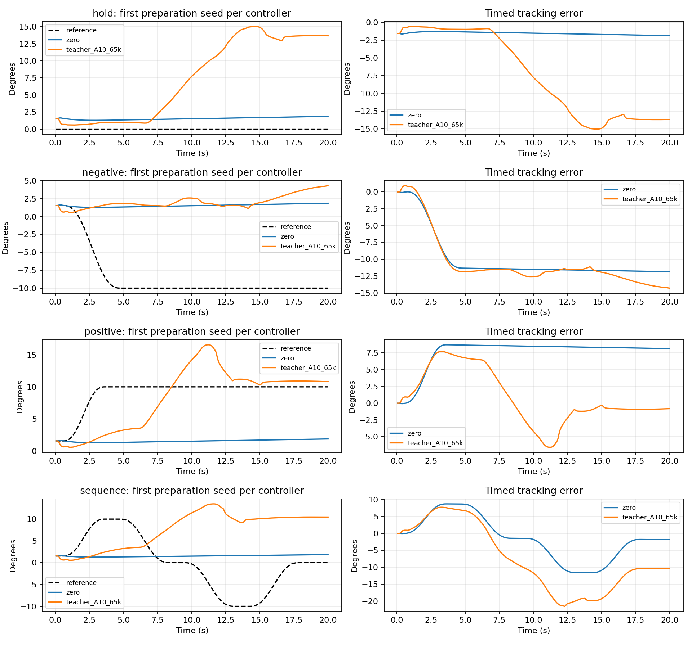

# Frozen evaluation comparison

All errors in degrees. These are small-angle tracking results, not stage-1 handover acceptance.

| Model | Case | n | RMSE mean ± SD | Tail RMSE | Worst peak | Complete | Tracking gate |
| --- | --- | ---: | ---: | ---: | ---: | ---: | ---: |
| zero | hold | 3 | 1.616 ± 0.062 | 1.841 | 1.998 | 3/3 | 3/3 |
| zero | negative | 3 | 10.686 ± 0.058 | 11.840 | 11.998 | 3/3 | 0/3 |
| zero | positive | 3 | 7.864 ± 0.059 | 8.160 | 8.706 | 3/3 | 0/3 |
| zero | sequence | 3 | 6.556 ± 0.014 | 4.831 | 11.807 | 3/3 | 0/3 |
| teacher_A10_65k | hold | 3 | 7.674 ± 2.440 | 10.857 | 15.013 | 3/3 | 0/3 |
| teacher_A10_65k | negative | 3 | 11.273 ± 0.038 | 13.340 | 14.420 | 3/3 | 0/3 |
| teacher_A10_65k | positive | 3 | 6.537 ± 3.486 | 6.605 | 18.360 | 3/3 | 0/3 |
| teacher_A10_65k | sequence | 3 | 13.493 ± 1.687 | 15.134 | 27.155 | 3/3 | 0/3 |

Tracking gate: complete declared duration, RMSE ≤2°, peak ≤5°. Tail means last 100 policy steps (5s at 20Hz).

Preparation seeds are not training seeds. A successful contact candidate is not proof of load transfer.

