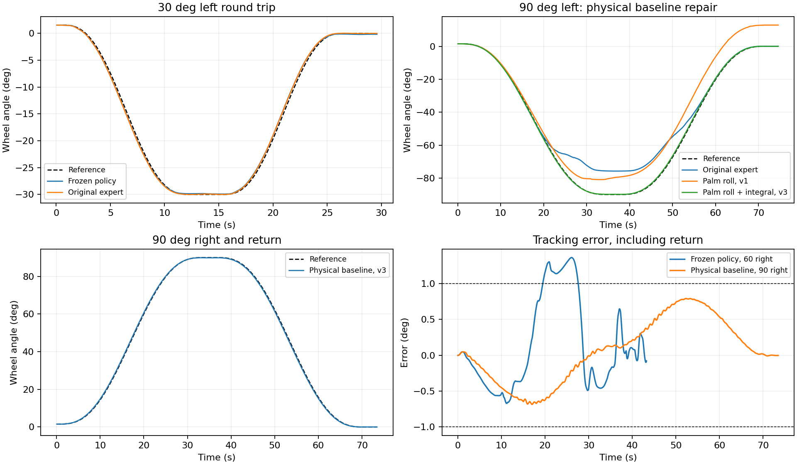

# 新版R0首轮审计与90°物理入口（2026-10-28）

**旧网络未更新，原场景与硬件约束未修改。冻结网络双手30°诊断6/6通过；改进的显式物理基线90°往返6/6通过。新版R1的网络90°能力尚未通过。**

## 本轮做了什么

- 76条诊断轨迹，另4条被动插桩复现；52个角度/姿态模式的静态搜索点，每手每点5个初值。不是论文独立验收或独立训练种子统计。
- 参考为0.5秒真实初始轮角保持→绝对目标角→3秒保持→绝对零位→3秒保持，峰值5°/s。90°往返约73–75秒，没有用22秒前缀充当完整任务。
- 标准双手空间手位约9.006/2.999点；seed40001闭合settling后轮角1.549°。单手reset轮角可漂移到5.745°或−1.936°，因此不宣称任务初态已精确标定为零。
- 正轮角是驾驶者视角顺时针/右转，左转用负号；网络接口保持旧符号。轮角为累计弧度，预览误差按10°缩放但不裁剪，未发现目标正负被归一化抹掉。

## 冻结网络：确有可复用能力，也有真实失败

- 双手±30°在40001/40011/40021三个诊断种子全部通过，最差全程RMSE 0.400972°。
- 45°复核：左转网络0/2、原物理基线2/2；右转网络2/2、基线2/2。此处是策略缺口，不能说硬件做不到。
- 双手60°：左转约−56.10°触发左拇指近端偏航关节越界；右转最大到约58.86°，但失败发生在返程约+3.91°的右腕俯仰2°余量门槛，不能误写成只转到59°就失败。
- 右手单独支撑左转90°完整执行，全程RMSE约0.956°，目标保持峰值约1.570°，因此未通过；它不代表双手90°或180°已学会。
- 四条被动回放的轮角和时间逐样本与原始诊断相同；定位错误没有改变物理轨迹。

## 几何与物理基线的修复

- 严格保持掌姿随轮刚性旋转时，下方手60°/90°的静态误差明显；仅位置可达并不代表能握住。
- 允许绕局部轮辋切线调整掌姿后，多初值搜索找到双手90°静态解；正反部分180°组合仍有碰撞或不一致，不据此宣布180°完整通路通过。
- 动态基线依次比较原专家、切线掌姿v1、积分相位限幅10°的v2、限幅30°的v3。v1六例0/6；v2六例4/6（30°/60°通过，90°返程失败）；v3在90°三种子双方向通过。全部失败保留。
- v3将掌姿和掌部相对轮辋的偏移一起绕切线旋转，轮角误差只用于显式基线的内部参考相位积分。30°是该积分参考的抗饱和范围，真实腕部位置领先量仍12mm、姿态领先量10°，臂5°/手0.15rad领先量、手指0.35Nm和2°实测臂余量均未放宽。
- 这些脚本只作物理可行性和候选标签来源，未装入学习策略执行层，没有改写物理qpos、执行器目标或网络动作。

| 90°物理复核项 | 结果 |
| --- | --- |
| 三种子双方向 | 6/6 |
| 最差全程RMSE | 0.444134° |
| 最差目标保持峰值 | 0.141207° |
| 最小实测臂余量 | 2.012139° |
| 碰撞峰值/累计QP失败 | 0.000000N / 0 |

## 接口与角色审计差异表

| 项目 | 本轮已核对实现 | 后续处理边界 |
| --- | --- | --- |
| 观测/动作 | 沿用v4的152/54/16输入编码及24动作，轮角不取模、预览不裁剪 | 保留旧权重兼容性；接口改动需单独版本化 |
| 腕与手 | 腕平移/转动积分；手为0.995泄漏、0.03rad/20Hz增量，名义领先量0.15rad | 专家只输出相同动作；不改执行器接口 |
| 时序参考 | 新诊断参考按绝对时间读command_angles，含绝对零位返回；旧22秒评价未复用 | 尚未实现通用上游带时间戳序列API；继承set_target仅±30° |
| free_side | 控制reset离轮手准备；执行时所有24通道仍可动，没有永久禁接触硬条件 | 旧验收另要求离轮手峰值≤0.2N，不能沿用为新版R2通用门槛 |
| 抓握奖励 | 支持项取两手包围最大值/任一手接触；A课程无恢复奖励 | 没有永久双手紧握奖励；仍须补有效转矩/滑移的承载评价 |
| 终止 | 双手持续失联、负载、轮角包络、实测关节/碰撞等保护仍有效；诊断首次QP失败即停 | 允许释放一手，禁止把隐藏支撑、裁剪或失败前缀计为完整成功 |

本轮诊断通过判据为完整执行、20Hz全程RMSE≤1°、500Hz目标保持及最终3秒峰值各≤1°、异常碰撞峰值≤1N且无硬终止/首次QP失败。全程瞬时峰值另外报告；这不是新版R1的72例独立验收，也没有用全程RMSE代替未来的运动段指标。

## 已查明、尚未解决的边界

- 当前物理止挡±450°；配置幅度校验100°、任务终止110°、物理步轮角保护440°。继承的公共`set_target`还限制±30°，而当前时序更新读内部command_angles；通用上游角度序列接口尚待版本化。540°没有实现，不能只改一个参考数字。
- v3仅证明名义抓握下的一次90°往返及3秒保持，未证明10秒保持、两方向连续模板、末端恢复9/3点、连续重复及泛化。部分往返后手位相对起点有滑移；这是后续需要约束/评价的状态，不能隐藏。
- 新专家有内部参考相位状态，尚未证明现有观测下的标签可学性和闭环模仿效果；不能将物理基线6/6算作网络6/6。
- 180°上方手主导、动态释放与回正尚未验证；540°行程版本仍未修改。
- 新增参考、无物理状态改写检查4项及原结构化安全/观测检查7项，共11项通过，日志`outputs/driving_r0_checks_v1.log`。

## 下一步

新版R0分段放行0–90°名义往返的物理入口；先在R1.1做小预算示范辅助的标签/闭环学习验证，再补长保持与双向序列。旧模型继续冻结，示范与网络成绩分开；进入PPO前适配critic与探索噪声。R0对180°和540°的未完成项目按对应入口继续审计，不启动R3换手。

## 原始证据

- [driving_r0_v1](../driving_r0_v1/README.md)。
- [driving_r0_confirmation_v1](../driving_r0_confirmation_v1/README.md)。
- [driving_r0_roll_v1](../driving_r0_roll_v1/README.md)。
- [driving_r0_roll_v2](../driving_r0_roll_v2/README.md)。
- [driving_r0_roll_v3](../driving_r0_roll_v3/README.md)。
- [driving_r0_roll_confirmation_v3](../driving_r0_roll_confirmation_v3/README.md)。
- [原始元数据与初始手位](../driving_r0_v1/metadata.json)。
- [失败关节与被动插桩一致性](../driving_r0_v1/failure_details.json)。
- [刚性/仅位置静态搜索](../driving_r0_geometry_v1/summary.json)。
- [切线掌姿静态搜索](../driving_r0_geometry_roll_v1/summary.json)。
