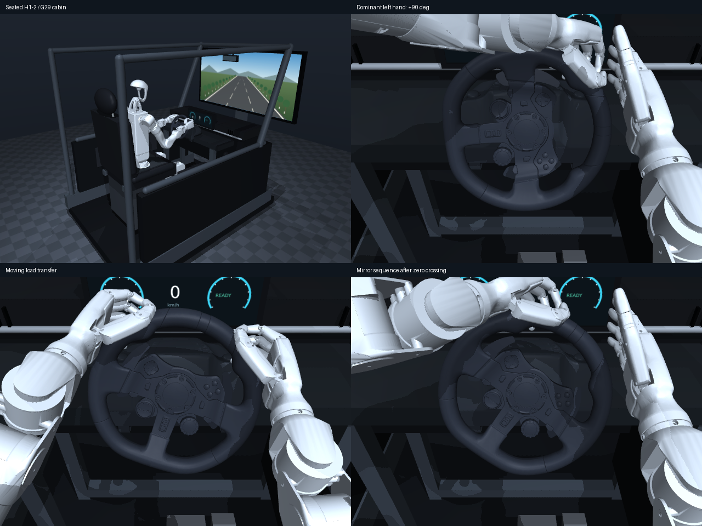
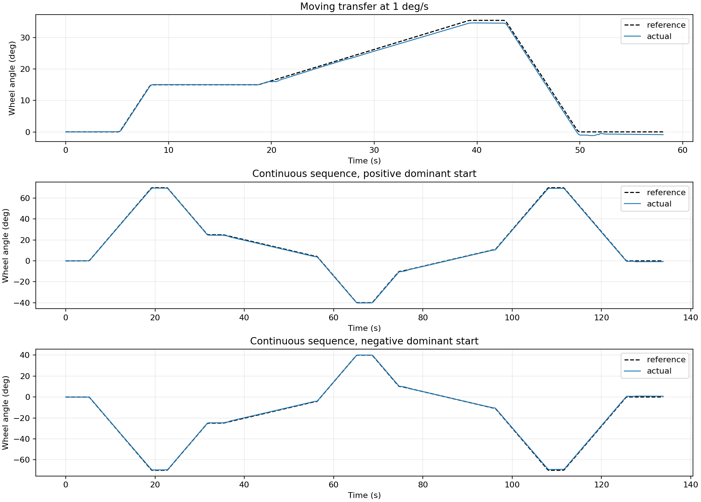
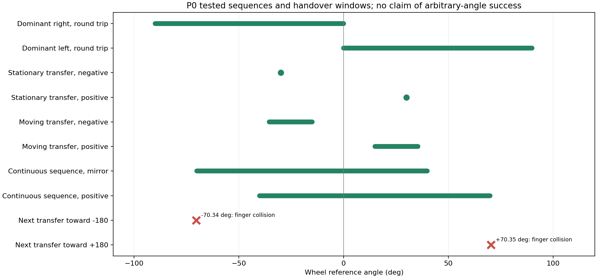

# 仿真P0验收：主导手转向、承载交接与连续指令

> 路线更新：本报告现为历史记录。左右90°已[独立备份](../archive/20261107_pre_palm_primary/README.md)，原结果保留，不作为新路线的初态、训练数据或通过证据。当前采用[三层研究计划v4.0](../../docs/plans/RESEARCH_PLAN.md)，下一步为第一层F0／F1；[历史经验](../../docs/experiments/HISTORICAL_LESSONS.md)已另行整理，新实验尚未执行。

2026-11-07。**本轮仿真P0工程检查已完成：基础入口通过，连续范围的边界已记录。** 用户明确实物暂无接口／标定，本轮不等待实物；后续在[R0](../../docs/plans/R0_HARDWARE_CALIBRATION.md)单列。没有开展策略训练或实物实验。

按当时计划可进入P1；现已转为掌部主导新P0，旧片段仅作参考。**完整±180°仍未通过**：当前候选再次换手时两手会碰撞，需要另找接管区域和接近路线。360°／540°属于后续研究任务，本轮没有完成，也没有降低其目标。

## 先看动作

[打开本地图文与视频页](index.html)。下面视频均来自完整物理轨迹回放；画面中的PASS／FAIL来自外部评价器。默认相机是轮盘近景，交互回放还可切换驾驶室全景。

| 内容 | 完整视频 |
| --- | --- |
| 双向90°往返，主导手转动、另一手退开 | [右转](../../outputs/p0_complete_20261107/nominal_v4/B_right90/replay_driver.mp4) · [左转](../../outputs/p0_complete_20261107/nominal_v4/B_left90/replay_driver.mp4) |
| ±30°停稳交接，含交接前后各10秒单手承载 | [正向](../../outputs/p0_complete_20261107/nominal_v4/D_right30/replay_driver.mp4) · [反向](../../outputs/p0_complete_20261107/nominal_v4/D_left30/replay_driver.mp4) |
| 1°/s继续转动中交接，参考从±15°走到±35.5° | [正向](../../outputs/p0_complete_20261107/moving_right15_v4/replay_driver.mp4) · [反向](../../outputs/p0_complete_20261107/moving_left15_v4/replay_driver.mp4) |
| 134秒连续序列：同侧反向、跨零、两次交接和回正 | [正向起始](../../outputs/p0_complete_20261107/continuous_positive70_v5/replay_driver.mp4) · [镜像起始](../../outputs/p0_complete_20261107/continuous_negative70_v5/replay_driver.mp4) |
| 保留的失败：镜像连续序列无名指失接触，角度仍达标 | [修复前完整视频，明确标FAIL](../../outputs/p0_complete_20261107/continuous_negative70_v4/replay_driver.mp4) |



从项目根目录打开可拖动视角的回放：

```bash
bash scripts/run.sh -m humanlike_drive.env_runner.replay_p0 \
  --run outputs/p0_complete_20261107/continuous_negative70_v5
```

默认暂停。空格播放／暂停，R重播，V切换相机，鼠标调整视角，+／-调整速度。回放只显示记录状态，不生成新的成功证据；原始轨迹和接触记录才是数值来源。查看初态可用现有查看器传入该运行的`--scene`和`--poses`。

## 本轮证明了什么

- A：双手零位10秒保持、左右手分别释放并维持10秒，均通过。零位片段不单独证明非零负载承载。
- B：双向30°、60°、90°完整转动、保持和回正均通过。主导手运动时另一手离开轮圈；没有强迫两手固定抓点全程共转。
- C：在±30°，两手分别完成交接前／后10秒独立支撑。最小声明负载绝对值约0.0515 Nm，逐手平均反负载力矩约0.056–0.059 Nm，另一手的轮圈力为0 N；六类支撑接触均为100%。这是D轨迹中的独立阶段核对，不另算四次独立试验。
- D：双方向停稳交接通过。新手先接触并承载，随后旧手释放；接管后新手独立保持10秒，再回正。
- E：双方向运动交接通过。参考在交接中持续以1°/s前进；承载交叠连续约2.88秒／3.65秒，旧手释放及新手独立支撑期间的相对参考误差变化约0.42°／0.29°。
- F：`0→+70→+25→−40→+70→0`及其镜像通过。两次交接中参考持续走动，途中不重置轮角、驱动目标或抓握状态；每次保持和交接分别验收。两个序列运动RMSE为0.380°／0.367°，时长均约133.8秒。途经点保持时任务目标与时间参考分开记录；过渡操作没有被伪装成用户目标。

15个名义任务案例全部满足各自P0门槛；它们是调试后的单次回归，**不是成功率或泛化结论**。全体通过案例的最小手臂余量约2.86°，轮圈最大穿透0.375 mm，前臂与手掌夹角峰值约25.8°；没有>0.05 N的非轮圈或非法碰撞。拨片几何间隙最小约4.59 mm，按50 Hz离散采样，不宣称连续几何最小值。

拟人性体现在主导手／释放手分工、有序交接和较顺直的腕姿；尚未用人类示范量化相似度。本轮没有继续逐关节精修抓握。

## 逐例结果

门槛保持：运动RMSE≤2°，每次保持末1秒峰值≤2°；主动支撑手四指、掌部、拇指在整个评分保持段接触占比各≥95%；手臂余量>2°；真实限位、有限输出、非法碰撞、拨片受力及穿透均独立检查。重复出现的保持段分别评分，不能平均稀释失败。

| 案例／原始评价 | 结果 | 运动RMSE／° | 保持末段最坏峰值／° | 最小臂余量／° | 最大轮圈穿透／mm |
| --- | --- | ---: | ---: | ---: | ---: |
| [A_hold](../../outputs/p0_complete_20261107/nominal_v4/A_hold/evaluation.json) | 通过 | — | 0.042 | 15.63 | 0.000 |
| [A_left_support](../../outputs/p0_complete_20261107/nominal_v4/A_left_support/evaluation.json) | 通过 | — | 0.312 | 2.99 | 0.327 |
| [A_right_support](../../outputs/p0_complete_20261107/nominal_v4/A_right_support/evaluation.json) | 通过 | — | 0.156 | 3.04 | 0.329 |
| [B_left30](../../outputs/p0_complete_20261107/nominal_v4/B_left30/evaluation.json) | 通过 | 0.187 | 0.263 | 3.04 | 0.348 |
| [B_left60](../../outputs/p0_complete_20261107/nominal_v4/B_left60/evaluation.json) | 通过 | 0.164 | 0.452 | 3.01 | 0.375 |
| [B_left90](../../outputs/p0_complete_20261107/nominal_v4/B_left90/evaluation.json) | 通过 | 0.429 | 0.775 | 3.01 | 0.352 |
| [B_right30](../../outputs/p0_complete_20261107/nominal_v4/B_right30/evaluation.json) | 通过 | 0.184 | 0.350 | 2.99 | 0.367 |
| [B_right60](../../outputs/p0_complete_20261107/nominal_v4/B_right60/evaluation.json) | 通过 | 0.185 | 0.578 | 2.99 | 0.338 |
| [B_right90](../../outputs/p0_complete_20261107/nominal_v4/B_right90/evaluation.json) | 通过 | 0.586 | 1.091 | 2.99 | 0.344 |
| [D_left30](../../outputs/p0_complete_20261107/nominal_v4/D_left30/evaluation.json) | 通过 | 0.226 | 0.525 | 2.86 | 0.326 |
| [D_right30](../../outputs/p0_complete_20261107/nominal_v4/D_right30/evaluation.json) | 通过 | 0.209 | 0.475 | 2.88 | 0.370 |
| [negative_no_contact](../../outputs/p0_complete_20261107/nominal_v4/negative_no_contact/evaluation.json) | 按预期失败 | 17.576 | 29.916 | 2.98 | 0.000 |
| [moving_right15_v4](../../outputs/p0_complete_20261107/moving_right15_v4/evaluation.json) | 通过 | 0.612 | 0.890 | 2.93 | 0.359 |
| [moving_left15_v4](../../outputs/p0_complete_20261107/moving_left15_v4/evaluation.json) | 通过 | 0.446 | 0.624 | 2.91 | 0.367 |
| [continuous_positive70_v5](../../outputs/p0_complete_20261107/continuous_positive70_v5/evaluation.json) | 通过 | 0.380 | 0.711 | 2.96 | 0.343 |
| [continuous_negative70_v5](../../outputs/p0_complete_20261107/continuous_negative70_v5/evaluation.json) | 通过 | 0.367 | 0.853 | 2.93 | 0.364 |
| [boundary_positive180_v4](../../outputs/p0_complete_20261107/boundary_positive180_v4/evaluation.json) | 失败／边界 | 0.393 | 0.507 | 2.96 | 0.343 |
| [boundary_negative180_v4](../../outputs/p0_complete_20261107/boundary_negative180_v4/evaluation.json) | 失败／边界 | 0.323 | 0.417 | 2.92 | 0.348 |


负对照关闭轮盘接触后，运动RMSE约17.6°，按预期失败；完整轮轴输入仍只有声明负载。它与原始接触力矩核对共同支持本轮转向来自手与轮圈的物理接触。

[机器可读指标与逐例配置](measured_results.json)含实际电机目标变化率的额外核对：全部所列轨迹均未超过臂0.6 rad/s、手驱动1 rad/s。边界案例表中的误差仅覆盖提前停止前的前缀，不能视为完整任务精度。





图中绿色范围属于所列完整轨迹，不能外推任意指令成功。另保留[±180°离线姿态扫描](offline_posture_scan.json)；它的横坐标是手相对初始抓点的运动相位，不是累计轮角，IK位置误差小也不证明接管碰撞可行。

## 全范围为何还未通过

向+180°和−180°扩展的候选序列在约108.896秒／108.892秒遇到两手碰撞，立即停止。此时参考轮角约+70.346°／−70.342°，正在尝试下一次接管：

- 正向：左拇指末节与右中指中节碰撞。
- 镜像：左中指中节与右拇指末节碰撞。

[碰撞图](boundary.png)；[正向原始事件](../../outputs/p0_complete_20261107/boundary_positive180_v4/collision_events.json)；[镜像原始事件](../../outputs/p0_complete_20261107/boundary_negative180_v4/collision_events.json)。

这是**当前接管抓点与接近路线的限制**。单手90°已经通过，因此不能把±70°说成全局可达极限。后续需要让接收手采用不同区域或绕行，保持主导／释放关系，再复验更大范围；不靠关闭自碰撞或放宽限位绕过。

最初的运动交接在±30°起始窗口发生退手碰撞，保留在`moving_*30*`；随后在±15°窗口建立有效片段。连续镜像序列最初角度达标但左无名指持续失接触，不能算通过；有界接触恢复后通过。旧固定双手60°失败也只属于该版基线，不代表机器人的全局极限。

[全部已评价试验清单](all_trials.json)保留探索失败。边界运行的物理轨迹已完整保存；原评价器未处理尚未到达的空阶段而抛错，修复空阶段处理后重新读同一轨迹评价，未重跑物理或改门槛。对应`evaluation_source.py`和哈希随原运行保存。

## 实现与适用范围

初态使用`p0_clear_grasp_v1.json`。H1-2原限位、Inspire每手6独立驱动及URDF mimic保持。任务开始时仅加载一次准备初态，之后不用qpos重置或轮轴电机；离线IK和保存状态的可视化与物理执行分开。

机器人坐姿、G29水平底座和倾斜轮轴、大屏与驾驶室保留。启用机器人自碰撞，保留轮圈、拨片、轮辐、外壳和座舱碰撞；仅采用运行清单中四对已说明的装配排除。原mimic是软约束，通过案例最大偏差约0.080°，没有改成独立驱动。

物理500 Hz，策略动作接口20 Hz、26维目标变化率。底层对相邻限速目标线性插值；手臂补偿只作用于14个臂自由度，与电机力矩合计核对。腕姿优化与重抓路径来自离线IK，随后通过有限电机、接触物理实际执行。

手掌径向贴合目标1.5 N、最大修正3 mm，接触反馈先对50 ms内物理样本取平均。F组另启用四指接触恢复，目标0.15 N、积分增益0.3 rad/(N·s)、最大增量0.15 rad；本轮实际最大增量约0.0144 rad。它使用原四个独立手指驱动，释放后清零，不修改初态抓握或mimic。A–E未启用该可选功能。相关配置逐例保存，不能把接触真值当成后续学生的现成传感器。

轮轴外部负载为**未标定合成模型**：`tau=-0.1*theta-0.02*omega`，另保留原轮轴阻尼0.02 N·m·s/rad和干摩擦0.015 N·m。它证明该声明负载下的工程片段可行，不代表真实G29响应。原G29居中±450°行程也不支持最终±540°目标。

## 复现与数据

在项目根目录执行全套名义回归，使用新目录保留旧结果：

```bash
OPENBLAS_NUM_THREADS=1 bash scripts/run.sh -m humanlike_drive.env_runner.p0_suite \
  --output outputs/p0_regression_new --jobs 2
```

单独复现连续序列或失败边界：

```bash
OPENBLAS_NUM_THREADS=1 bash scripts/run.sh -m humanlike_drive.env_runner.p0_motion \
  --case continuous --angle -1 --maximum 70 --contact-grip \
  --output outputs/p0_continuous_new

OPENBLAS_NUM_THREADS=1 bash scripts/run.sh -m humanlike_drive.env_runner.p0_motion \
  --case continuous --angle 1 --maximum 180 --stop-on-constraint \
  --output outputs/p0_boundary_new
```

每例目录保存`scene.xml`、抓握、参数、源文件快照和哈希，以及500 Hz的`trajectory.npz`、`contacts.npz`、几何名称／单位、异常事件、评价和图表。轮角为累计弧度，展示时换成度；接触部位顺序是食指、中指、无名指、小指、掌部、拇指；命令、限速动作和实际电机目标分别记录。拨片／轮辐几何间隙50 Hz取样，并标出采样时刻。

[14项回归测试](tests.txt)全部通过；[9段完整视频](video_audit.json)均已核对时长并解码首尾帧；交互回放已在本机显示环境启动并渲染首帧。模型源和关键实现的当前哈希见[实现清单](implementation_manifest.json)；具体运行时版本以各运行`source_snapshot/`和`manifest.json`为准。大体积轨迹及视频保留在本机outputs，未提交或推送GitHub。

旧路线原定下一步为P1；当前先按[第一层局部协议](../../docs/experiments/PALM_PRIMARY_P0.md)重新核对物理入口，并在第一层补齐完整任务可行性。已有方法适配与必要改进按[三层计划](../../docs/plans/RESEARCH_PLAN.md)依次开展，不预定学习方法；实物R0独立落实。
