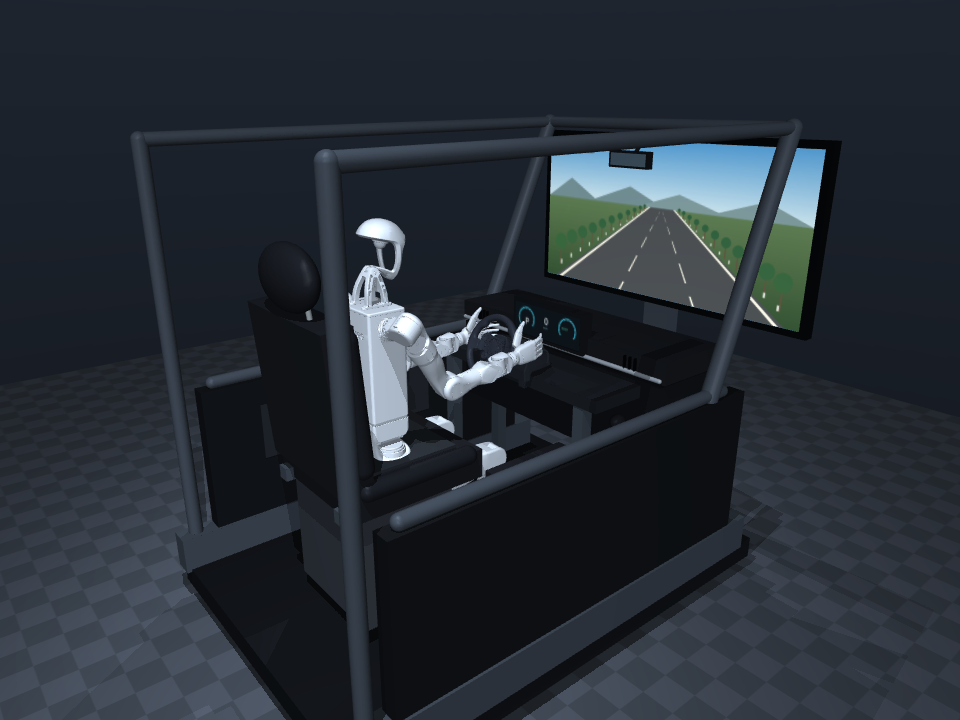
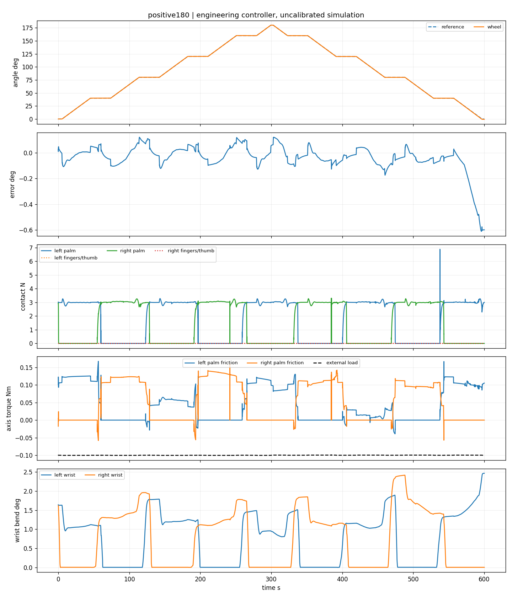
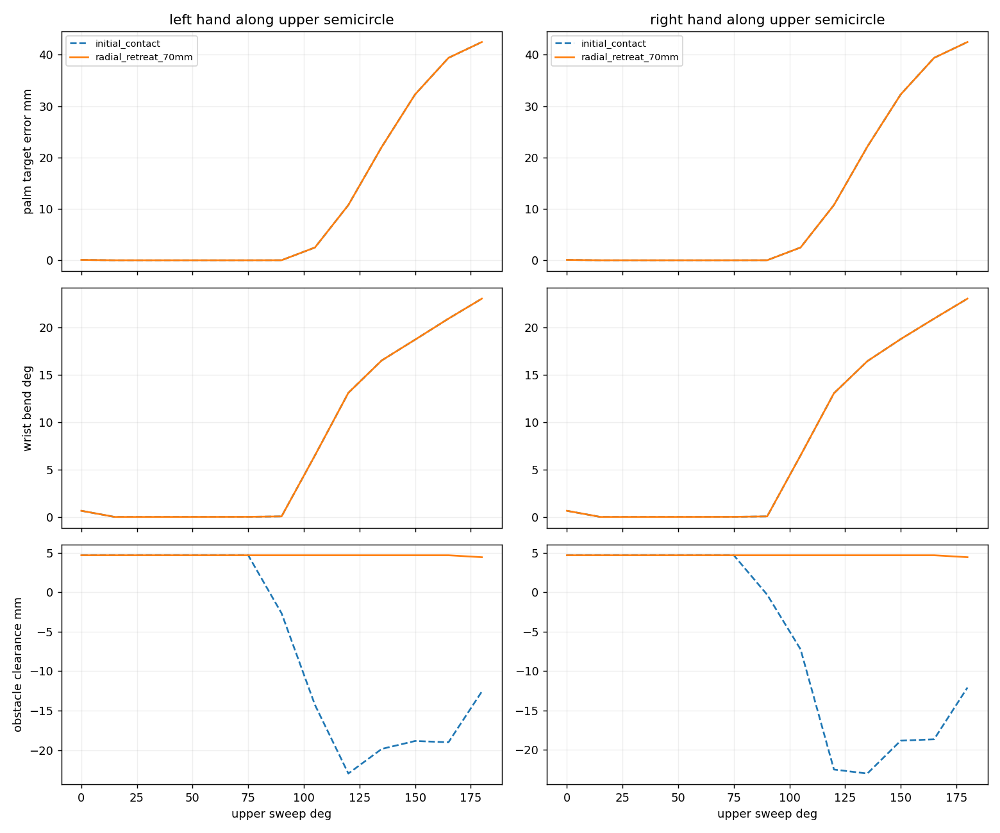

# 层1验收：掌心摩擦驱动方向盘的非学习工程基线

日期：2026-11-07。**已完成当前仿真层1的代表范围：从自然9点／3点初态，依靠真实掌面接触和有限执行器，分别完成0→+180°→0、0→−180°→0。** 坐姿驾驶室、大屏、G29拨片／轮辐／底座保留。没有训练策略；实物仍待R0标定。

当前结论是“在明确条件下存在可执行的完整操作过程”，可作为第二层学习方法的物理入口。它不代表任意连续目标、全部上半圆动态可达或最终T1—T4完成。

## 1. 先看什么

- [视频与图片入口](index.html)：同页播放完整往返；视频均为**4倍速、不剪辑**，约150秒，对应约600秒物理过程。
- [+180°驾驶员视角](positive180_replay_driver.mp4)、[−180°驾驶员视角](negative180_replay_driver.mp4)、[+180°驾驶室全景](positive180_replay_cabin.mp4)。
- [逐例验收表](case_results.md)与[机器可读证据索引](evidence_index.json)：45个案例，保留失败、实际版本及源目录。
- [系统手册与复现命令](../../../docs/LAYER1_ENGINEERING.md)、[冻结控制参数](../../../humanlike_drive/config/controller/palm_primary_l1.json)。

窗口中可从任何帧观察接触，空格播放、V切相机、鼠标调整、+／−变速、R回到开头：

```bash
# 项目根目录 /home/nubot/humanlike_drive/humanlike_drive
bash scripts/run.sh -m humanlike_drive.env_runner.replay_p0 \
  --run outputs/physical_feasibility/l1_v3_20261107/core/positive180
```



## 2. 这套非策略范式怎样工作

这里“非策略”指**无学习的显式控制／规划系统**。它仍有闭环反馈和状态机，不是播放关节位置录像。

```text
累计轮角目标序列
    ↓
平滑角度参考 + 每手40°的上半圆接力安排
    ↓                    ↑ 接触稳定／负载转移／释放检查
轮角PI + 掌压导纳 + 接管转矩反馈
    ↓
离线自然腕姿IK路径与有界位姿修正
    ↓
20 Hz、26维归一化动作 → 限速执行器 → 500 Hz插值
    ↓
原有限机器人电机 → 实际掌面摩擦 → 被动方向盘
```

1. **建立接触。** 左9点、右3点，手腕尽量顺直；掌面压在轮圈外缘，手指采用统一轻握目标。有限电机完成12秒准备；任务使用已经验证的准备末态。
2. **短行程转向。** 主动手在自己一侧的上半圆沿轮圈走，轮角反馈修正切向目标，法向力反馈修正径向预紧。名义掌压目标3 N、瞬时上限8 N；整手上限10 N。
3. **停稳接管。** 旧手保持，新手退让并回准备位置、接近、建立稳定掌压、转移负载，旧手退出。新手独立保持10秒后继续。进入转移／释放前，条件不足可在上一稳定状态额外等待最多5秒；超时停止。负向180°实际多等0.2秒。
4. **统一累计轮角。** 接管不重置轮角、误差积分或控制器记忆；同一控制器处理正转、反转、保持和回正。每个180°往返8次接管，不是为180／360／540分别写动作模板。
5. **独立验收。** 逐物理步记录执行命令、接触和动力学，再检查任务、传力、滑移、腕姿、限位、输出及干涉。

源码职责：`controller/palm_steering.py`负责掌面点IK，`palm_relay.py`负责连续角度接力，`palm_contact.py`负责物理诊断，`palm_workspace.py`负责几何筛查；`env/palm_collision.py`建立独立掌部碰撞版本；`env_runner/physical_feasibility.py`执行和评分，`l1_suite.py`运行矩阵，`l1_verify.py`独立核对。

## 3. 冻结条件与完整180°结果

名义转向速度**1°/s**；恒定轮轴负载幅值**0.1 N·m**，附加阻尼0.02 N·m·s/rad，保留原轴重力、阻尼、干摩擦和armature。恒负载在一条往返中不随运动方向翻转，回程也检验制动。该负载是合成条件，**未经实物G29标定**。

采用椭圆摩擦锥、`impratio=10`、150次迭代、容差1e−10。原接触`solimp`不改。原26个有限驱动、关节限位、mimic、质量和惯性保留；电机与有界补偿之和受原输出上限约束；轮轴无电机，无任务中状态注入。

| 指标 | 0→+180°→0 | 0→−180°→0 |
| --- | ---: | ---: |
| 完整验收 | 通过 | 通过 |
| 物理时长 | 600.00 s | 600.20 s |
| 运动RMSE | 0.117° | 0.176° |
| 全程最大角误差 | 0.611° | 0.889° |
| 各停顿末1秒最大误差 | 0.599° | 0.886° |
| 最大掌面法向力 | 6.882 N | 4.325 N |
| 最大整手轮圈法向力 | 6.882 N | 6.071 N |
| 最长有效掌接触间断 | 2 ms | 2 ms |
| 左／右累计接触滑移 | 10.78／13.46 mm | 12.03／11.28 mm |
| 最大相对切向滑移速度 | 12.78 mm/s | 13.99 mm/s |
| 全程最大前臂—手掌折弯 | 2.46° | 2.59° |
| 最小臂关节限位余量 | 17.19° | 17.01° |
| 最大mimic关系误差 | 0.00353° | 0.00396° |
| 非法接触／拨片等非轮圈接触力 | 0 N | 0 N |
| 接管通过 | 8／8 | 8／8 |
| 每次接管后独立保持 | 10 s | 10 s |
| 掌面切向摩擦传力比例 | 85.6% | 80.9% |
| 保持／驱动／制动分段掌摩擦比例 | 82.6／88.8／85.9% | 76.7／81.4／86.7% |

传力比例按所需力矩同号片段的**有符号积分**计算，分开法向、摩擦和接触力偶；不是接触点占比，也不是正反相抵后的净值。世界接触力矩与广义接触力矩残差最大约5.3e−12 N·m，含干摩擦和转子惯量的轮轴动力学残差最大约7.9e−9 N·m。

接管不是旧手仍承载时假称完成：每次独立保持期间旧手轮圈总力均为0，新手平均反负载转矩约0.103—0.114 N·m，均继续后续转向。详情见[正向评价](positive180_evaluation.json)、[负向评价](negative180_evaluation.json)。

**四指作用需要如实限定。** 两条完整180°中，四指轮圈受力均为0；负向少量片段有拇指支撑，正向没有。当前证明了掌面主驱的可行性，没有证明“四指辅助提高稳定性”，也不能称包络抓握已完成。实际受载点集中在掌面靠近掌根的局部区域，局部坐标及与CAD的距离在审计中保存。



## 4. 上半圆可达与机械干涉

共筛查260个配置：两只手×13个15°间隔相位×另一手两种状态×五种轮盘材料角。这里改变轮角仅用于**离线几何筛查**，不作为动态成功。

| 另一手状态 | 左手从9点向上走 | 右手从3点向上走 | 解释 |
| --- | --- | --- | --- |
| 保留原初态接触 | 采样0—75°均通过 | 采样0—75°均通过 | 到90°出现双手拇指干涉 |
| 径向退让70 mm | 采样0—105°均通过 | 采样0—105°均通过 | 120°起出现腕姿／可达条件不满足，末端还可能有躯干干涉 |

这些是当前IK路径、离散采样及当前候选姿态的筛查结果，不是数学连续可行域，也不证明机器人绝无其他姿态。动态正式基线保守采用40°行程，实际掌面接触都保持在上半圆；没有宣称每只手能独立受载走完180°。



## 5. 工程矩阵与失败边界

45例由11个名义案例、16个左右单手负载案例、15个目标标定扰动案例及3个诊断案例组成。**名义11／11通过，负载12／16通过（四个0.40 N·m边界失败），扰动15／15通过；两个手指消融通过，无轮圈接触负对照按预期失败。** 不将负对照和边界探测混算任务成功率。逐例结果见[验收表](case_results.md)，精确源路径、失败项和配置哈希见[索引](evidence_index.json)。

- 名义覆盖双手保持、±15°／±30°局部往返、±90°／±180°接力往返，以及两个镜像的途中反向／跨零序列。较大角度未以每15°终点穷举；不据此声称任意目标已验证。
- 左右单手在±0.05、±0.10、±0.20 N·m下均通过；±0.40 N·m四例均失败，两例先暴露滑移速度，另外两例还出现精度、接触和压力等问题。这里只证明已测离散负载点，未二分搜索极限。
- 标定扰动保留合法准备初态，经有限电机施加各手径向／切向±1 mm范围的恒定目标偏差；摩擦0.7、负载−0.12 N·m、两者联合各5个固定种子，**各5／5通过，共15／15**。它是有限工程探测，不是随机物理初态或可靠性置信结论。
- 统一四指闭合目标从0.25 rad降到0.10 rad，±30°两个消融均通过；正向RMSE仍约0.0632°、累计主动掌滑移约2.69 mm，负向约0.0774°／3.15 mm，未观察到轻握支撑的稳定性收益。该比较含动作目标调整的过渡，不是人类抓握优劣评价。
- 取消全部轮圈接触后，+15°负对照不能跟踪，运动RMSE约457.5°，轮盘在外负载作用下转向机械止挡，并有软限位超出；它是预期失败诊断，不是合法任务通过。证据支持正式成功依赖手轮接触，轮轴没有隐藏角度驱动。

保留且不混算为当前通过的开发结果：

| 发现 | 处理与证据 |
| --- | --- |
| 原整掌凸包在视觉CAD外约7.4 mm假接触 | 废弃该证据，按原CAD表面分解碰撞体 |
| 原求解设置在恒定受载状态慢滑 | 同状态15秒漂移原设置2.056°、椭圆锥ratio10为0.119°；采用后者并公开设置 |
| 5°/s完整±180°角度走完，但掌压约40 N | 不通过8 N门槛；另冻结1°/s重新验收 |
| v2固定时间负90°接管接触稳定不足 | 原失败保留；v3增加有界原地等待，最终±180°完整重跑 |
| 已接触状态瞬时qpos扰动制造冲击 | 旧探针排除正式扰动统计，改为合法目标标定偏差 |

相关开发证据位于`outputs/physical_feasibility/development/`；v2失败仍保留在`l1_v2_20261107/checks_parallel/negative90/`及旧`perturb_*`中。**局部和负载测试沿用v2；完整±180°、负90°、正式目标扰动与诊断使用v3，不声称45例全部在v3重跑。** 两版差别为接管前有界等待，逐例实际源码均保存。

## 6. 为什么这是物理证据

1. [模型不变量核对](preparation_model_invariants.json)确认原状态维度、质量／惯性、关节轴／限位、轴摩擦／阻尼／armature、执行器输出／增益及mimic系数均不变，26有限机器人电机、被动轮轴有效。
2. 每掌421个CAD表面裁切凸列只替换原掌部不准确凸包，视觉和惯性不变。完整两方向分别抽查每掌250个受载接触及对应轮圈CAD，最大距离分别为0.0543／0.374 mm，均小于0.5 mm。见[正向CAD审计](positive180_contact_CAD_audit.json)、[负向CAD审计](negative180_contact_CAD_audit.json)。这是抽样真实性核查，不是全表面误差上界。
3. [正向动作重执行](positive180_action_replay_check.json)、[负向动作重执行](negative180_action_replay_check.json)从首帧状态重执行20 Hz记录动作，重新计算500 Hz插值、有界补偿和轮轴负载。双向各完整约600秒均通过，最大关节位置误差分别为1.42e−9／2.67e−10 rad，控制目标误差均为0。它与把状态写回查看器的“视频回放”分开。
4. 7项新单元检查通过，覆盖世界力矩／广义力矩、轮轴平衡、Jacobian滑移与接力不变量。历史旧测试仍有缺失模块依赖，未声称全仓库测试通过，见[测试说明](../../../tests/README.md)。

## 7. 交付、复现及下一层入口

原始数据不剪辑，分别位于`outputs/physical_feasibility/l1_v2_20261107/`和`l1_v3_20261107/`。每例包含XML、配置、源码快照／哈希、实际准备状态、500 Hz轨迹与接触、20 Hz真实动作、名义／实际接力计划、转换检查、评价和失败原因。精选视频、图片及关键JSON在本目录；`frozen_protocol.json`含正式条件与预声明矩阵，两个360°扩展列出但尚未执行。

完整复现顺序和命令见[工程手册](../../../docs/LAYER1_ENGINEERING.md)。重新生成本报告的逐例机器索引：

```bash
python scripts/summarize_layer1.py
```

当前可以进入**相同物理条件、相同±180°代表范围**的第二层方法适配。完整成功轨迹是仿真工程专家候选，已保存实际执行动作；它们不是人类示范，也不是覆盖充分的BC训练集。正式训练前须决定部署观测、示范覆盖、完整轨迹划分及留出任务。

当前明确限制：低速、停稳接管效率较差；使用仿真掌力／逐手力矩真值；未验证任意在线目标重规划、外界推扰或实物；没有量化人类动作相似性；四指辅助收益未成立；360°未验收，540°还超出原G29居中±450°机械行程。实物继续按[R0](../../../docs/plans/R0_HARDWARE_CALIBRATION.md)单列。
